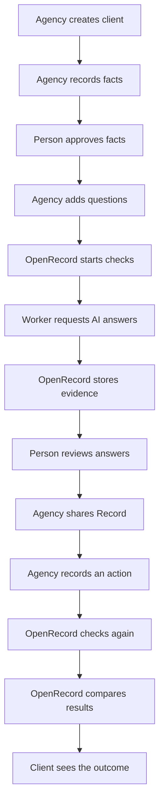
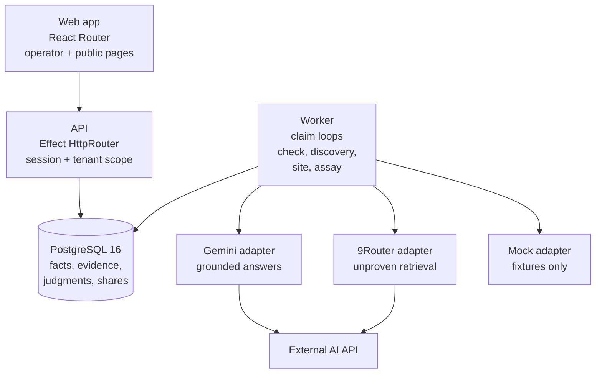
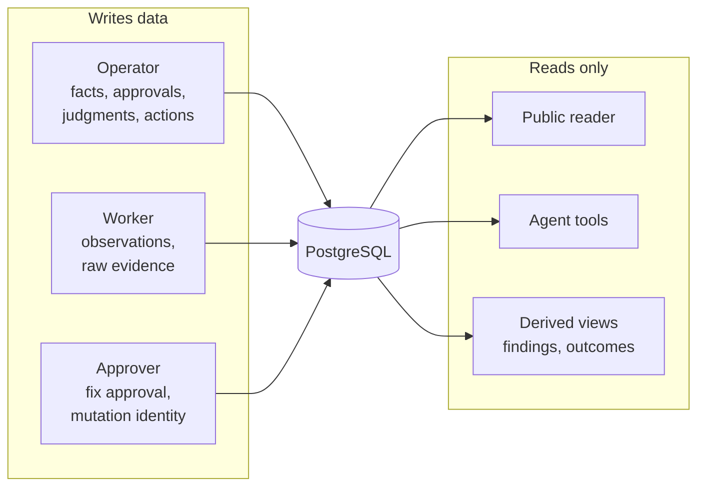

# OpenRecord Product Map (STE100 v1)

Starting commit: `decb5fec1760aa1d294e24d4bbf93e94c8f8754a` (`origin/main`).
Source of truth: the code at that commit. Older documents serve as background only.
Writing standard: ASD-STE100 Issue 9 rules as supplied in the task (short sentences, active voice for instructions, one topic per paragraph, consistent terms). The official dictionary is not freely available, so this document reports `STE_ALIGNED_NOT_FULLY_VERIFIED`.

## Executive summary

OpenRecord records what a business approves as true. It observes what AI systems answer about the business. A person reviews each difference. The agency shares the result with the client through one read-only link. The product code is complete and merged. Live validation with real businesses has not occurred. No customer has paid.

## 1. What OpenRecord does

OpenRecord is an evidence system for agencies. Agencies improve how AI systems describe their clients. OpenRecord proves the before-and-after result with stored evidence. It shows no scores. It claims no causation.

The product motto is:

> Observation is not interpretation. Interpretation is not authority. Correlation is not causality. Unknown is not false.

Source: `README.md` (product motto and design rules).

## 2. Who uses OpenRecord

Two readers use this map. Two users use the product.

| User | Plain meaning | Source |
|---|---|---|
| Agency operator | A person at an agency. The person approves facts, reviews AI answers, records actions, and shares records. | `apps/web/app/routes/client.tsx` (`ClientRecordPage`), `apps/api/src/record-routes.ts` (session attribution) |
| Client reader | A person who opens a shared link. The person reads facts, answers, judgments, and outcomes. The person cannot change data. | `apps/web/app/routes/public-record.tsx` (`PublicRecordPage`), `GET /api/public/records/:publicId` in `apps/api/src/record-routes.ts` |

Related term: **Account**. An account is the agency tenant. Every business belongs to one account. Sessions scope all reads and writes to the account. Source: `apps/api/src/router.ts` (`requireSession`, `getScoped`).

## 3. What the customer receives

The customer receives one read-only web link. The link shows three approved facts. The link shows the exact question asked for each fact. The link shows the exact AI answers with sources. The link shows a human judgment for each answer. The link shows the weekly re-check and its observed outcome. The link owner can revoke the link. A revoked link shows the same error as an unknown link. Source: `packages/db/src/record-view.ts` (`publicRecord`), `apps/api/src/record-routes.ts` (revocation behavior).

The customer does not receive a score. The customer does not receive a visibility percentage. The customer does not receive a claim that an action caused a change. Source: `packages/db/src/record-view.ts` (`CAUSALITY_DISCLOSURE`).

## 4. Main workflow diagram

Verified against `apps/web/app/routes/client.tsx`, `apps/api/src/record-routes.ts`, `apps/worker/src/check-runner.ts`, and `packages/db/src/record-view.ts`.

## 5. Main workflow steps

Terms: `AUTOMATIC` means software acts alone. `HUMAN_REQUIRED` means the workflow stops without a person. `MANUAL_EXTERNAL` means work happens outside OpenRecord.

| # | Step | Actor | Type | Input | Action | Output | Screen or API | Stored data | Possible failure | Evidence |
|---|---|---|---|---|---|---|---|---|---|---|
| 1 | Agency creates client | Operator | HUMAN_REQUIRED | Name, website URL, engagement label | Submit the client form | Client record with empty slots | `ClientsPage` (`apps/web/app/routes/clients.tsx`), `POST /api/record/clients` | `record_profiles` row | Invalid URL is rejected | `apps/api/src/record-routes.ts` (`CreateClientRequest`) |
| 2 | Agency records facts | Operator | HUMAN_REQUIRED | Subject, predicate, value, type, source URL, question, truth authority | Save each slot | Unapproved slot version | `SlotEditor` in `client.tsx`, `PUT /api/record/clients/:id/slots/:slot` | `authoritative_facts` row, `record_items` row, `buyer_questions` row | Bad validity window is rejected | `packages/db/src/record.ts` (`saveSlot`) |
| 3 | Person approves facts | Operator | HUMAN_REQUIRED | Slot version | Approve the fact | Approved slot | Approve control in `client.tsx`, `POST .../items/:itemId/approve` | `record_item_approvals` row, write-once | Approval of a superseded version is refused | `packages/db/src/record.ts` (`approveItem`), migration `0022_client_record_v1.sql` (`guard_record_approval`) |
| 4 | Agency starts checks | Operator | HUMAN_REQUIRED | Run kind, sample count 1–5 | Start the run | Queued checks, N per approved fact | Run controls in `client.tsx`, `POST .../runs` | `record_runs` row, `check_runs` rows in `QUEUED` | A second run during an active run is refused; expired facts block the run | `packages/db/src/record.ts` (`startRun`: `RunInProgress`, `FactNotCurrentlyValid`) |
| 5 | Worker requests AI answers | Worker | AUTOMATIC | Queued check | Claim the check, call the provider, store the answer | Succeeded or failed check | No screen; worker loop | `observations` row, `raw_evidence` row, `observation_citations` rows, or failure class on the check | Missing key, bad model, timeout, rate limit, provider outage | `apps/worker/src/check-runner.ts`, `packages/providers/src/gemini.ts` |
| 6 | OpenRecord stores evidence | Worker | AUTOMATIC | Provider response | Persist exact bytes with digest | Immutable evidence | No screen | `raw_evidence` digest-verified, append-only | Digest mismatch aborts the write | `packages/db/src/repositories.ts` (`ObservationRepository.create`) |
| 7 | Person reviews answers | Operator | HUMAN_REQUIRED | Answer text, optional exact quoted span | Judge each sample MATCHES, CONTRADICTS, or UNKNOWN | Reviewed judgments pinned to fact versions | `Review` in `client.tsx`, `POST .../judgments` | `record_claims` row if quoted, `record_judgments` row | A span outside the answer is rejected; a non-member reviewer is rejected | `packages/db/src/record.ts` (`judge`), migration `0024_record_integrity_v1.sql` (`guard_record_judgment`) |
| 8 | Agency shares Record | Operator | HUMAN_REQUIRED | Client record | Create the link | Capability URL | `Share` in `client.tsx`, `POST .../share` | `record_shares` row, `ACTIVE` | Fixture engagement needs an explicit flag | `apps/api/src/record-routes.ts` (`recordFixtureAllowed`) |
| 9 | Agency records an action | Operator | HUMAN_REQUIRED | Slot or whole record, note, link, date | Record what changed | Action evidence | `ActionForm` in `client.tsx`, `POST .../actions` | `interventions` row plus `record_actions` link | Future dates are rejected | `apps/api/src/record-routes.ts` (`ActionRequest`) |
| 10 | OpenRecord checks again | Operator starts, worker runs | HUMAN_REQUIRED then AUTOMATIC | Follow-up run request | Repeat the same policy | Second evidence set | Run controls, worker loop | New `record_runs` row of kind `FOLLOW_UP`, new checks | A changed sample count is refused; a changed surface yields `SURFACE_CHANGED` | `packages/db/src/record.ts` (`SamplingPolicyChanged`), `packages/db/src/record-view.ts` (`compareSlot`) |
| 11 | OpenRecord compares results | Software | AUTOMATIC | Reviewed before and after samples | Derive the outcome | `OBSERVED_CORRECTED`, `NO_OBSERVED_CHANGE`, `INDETERMINATE`, or `RESOLVED_EXTERNALLY` | Comparison panel in `client.tsx`, comparison section in `public-record.tsx` | Nothing stored; derived on each read | Unreviewed work stays private; changed fact or question blocks comparison | `packages/db/src/record-view.ts` (`compareSlot`) |
| 12 | Client sees the outcome | Client reader | AUTOMATIC | Shared link | Open the link | Full evidence record with disclosure | `PublicRecordPage`, `GET /api/public/records/:publicId` | Nothing new stored | Revoked link shows 404 | `packages/db/src/record-view.ts` (`publicRecord`) |

External manual work: the agency edits its own website or content. OpenRecord never edits external property except one narrow site-operator path (see section 7C). Type: `MANUAL_EXTERNAL`.

## 6. Product screens

| Screen | Route | User | Purpose | Input | Output | Next action |
|---|---|---|---|---|---|---|
| Sign in, Sign up | `/signin`, `/signup` | Operator, unauthenticated | Open a session | Email, password | Session, remembered email | Open Clients |
| Clients | `/clients` | Operator | List and create clients | Search, name, website, engagement | Client list, share badges | Open a client record |
| Client Record | `/clients/:id` | Operator | Run the full record workflow | Slots, judgments, actions, runs, share | Slots, findings, comparisons, share URL | Approve, run, review, act, re-check, share |
| Public Record | `/open/:publicId` | Public reader | Read forwarded evidence | Link only | Facts, samples, outcomes, disclosure | None; read-only terminal |
| Businesses | `/businesses` | Operator | Triage all businesses | Search, sort | Attention counts, support rate | Open a business |
| Business overview | `/businesses/:id/overview` | Operator | Dashboard or agent chat | View toggle | Analytics or agent chat | Drill into issues, checks, truth |
| Truth | `/businesses/:id/truth` | Operator | Version approved facts | Fact fields, supersede, retire | Fact history, conflicts, provenance | Check sources, review issues |
| Checks | `/businesses/:id/checks` | Operator | Ask buyer questions | Provider, prompt, run controls | Questions, answers, verdict bars | Review an answer |
| Observation | `/observations/:observationId` | Operator | Enter human verdicts | Claim text, verdict, linked facts | Claims, judgments | Open the issue |
| Issues | `/businesses/:id/issues` | Operator | Triage claims | Filters, search | Grouped claims, answers table | Open an issue |
| Issue detail | `/businesses/:id/issues/:claimId` | Operator | Resolve one claim | Verdict, intervention, recheck | Loop timeline, comparison | Record action, recheck |
| Representations | `/businesses/:id/representations` | Operator | Monitor published values | Filters, check controls | Fact-versus-page matrix | Open a binding |
| Representation detail | `/businesses/:id/representations/:bindingId` | Operator | Audit one fact at one URL | Check now | Approved versus published, history | Fix the source, re-check |
| Discovery | `/businesses/:id/representations/discovery` | Operator | Find trackable pages | Scope URL, scan, track controls | Candidate pages | Track a page |
| Search | `/businesses/:id/search` | Operator | Keep the site crawlable | Site, inspect, filters | Findings by kind and status | Open a finding |
| Site run | `/businesses/:id/search/sites/:siteId/runs/:runId` | Operator | Audit one crawl | Run id | URLs, digests, events | Return to search |
| Site finding | `/businesses/:id/search/sites/:siteId/findings/:findingId` | Operator | Fix one problem | Prepare, approve, apply, verify | Proposal, mutation, verification | Verify on the live site |
| Prospect Assay | `/businesses/:id/assay` | Operator | Hold unconfirmed proposals | Source URL, run config, reviews | Proposed facts, findings | Confirm a fact, review a finding |
| Agent chat | `?view=agent` on overview | Operator | Ask the read-only agent | Message | Answers, check proposals | Approve a proposed check |

Sources: `apps/web/app/main.tsx` (routes), route files in `apps/web/app/routes/`, `apps/web/app/lib/record.ts` (record client).

## 7. Supporting workflows

### A. Agency Record

The operator creates a client with website and engagement (`CLIENT`, `DOGFOOD`, `FIXTURE`). Each of 3 slots holds one fact, one source URL, and one buyer question. A person approves each slot version. A run checks every approved slot N times (N = 1–5, fixed per baseline). The worker answers through the configured surface. The operator judges each sample and may quote an exact span as a claim. The operator records actions per slot or for the whole record. A follow-up run repeats the policy. The read model derives one finding and one outcome per fact. The operator shares a revocable link. Revocation is permanent. Sources: `packages/db/migrations/0022_client_record_v1.sql`, `0024_record_integrity_v1.sql`, `packages/db/src/record.ts`, `packages/db/src/record-view.ts`.

### B. Prospect Assay

The operator registers a public source URL with subject and term lists. The worker fetches the page and proposes facts deterministically (`PRICE`, `PLAN_AVAILABILITY`, `BOOLEAN_CAPABILITY`). Sample groups ask a question N times (N = 1–20). The system derives findings only from confirmed facts. Required human reviews: confirm, reject, or mark each proposed fact ambiguous; review each finding correct, false positive, or not meaningful; retract confirmed facts when wrong. Unreviewed proposals never enter truth. Sources: `packages/db/src/assay.ts`, `apps/api/src/assay-routes.ts`, `packages/representation/src/assay-extraction.ts`, migration `0019_prospect_assay_v1.sql`.

Truth authority labels:

- `BUSINESS_APPROVED`: the business approved the fact. It supports MATCHES, CONTRADICTS, and UNKNOWN.
- `PUBLIC_SOURCE_UNAPPROVED`: the fact comes from public first-party pages only. The product language is "This differs from what your current website says." The product never says "This is wrong."

Sources: migration `0025_validation_truth_labels.sql`, `packages/db/src/record.ts` (`RecordSourceKind`), `apps/web/app/routes/public-record.tsx` (Mode B language).

### C. Search Operator

The worker inspects owned sites page by page (robots and sitemap honored, budgets enforced). It derives findings of 20 kinds (missing titles, bad canonicals, noindex blocks, broken links, and others). It proposes fixes with exact patches. A person approves each fix by hash. Only one fix kind executes today: removal of a noindex meta tag, applied as a git branch that is never merged automatically. All other kinds require manual work ("apply by hand, then verify"). Verification re-crawls the URL. Google Search Console status is read-only. Sources: `packages/site-operator/src/fixes.ts`, `packages/site-operator/src/mutation.ts`, `packages/site-operator/src/adapter.ts`, `apps/worker/src/site-inspection-runner.ts`, `apps/api/src/site-mutations.ts`.

The Search Operator is not integrated with Record Integrity. No code path feeds site findings into record judgments or record outcomes.

### D. Agent Tools

The agent exposes 8 read-only tools: business truth, buyer questions, open issues, representations, discovery scopes, one observation, one issue, record outcomes. The tool list is exact and tested. Adding a write tool requires a boundary review. The agent can only propose one write: `REQUEST_CHECK`. A person approves the proposal. Approval executes the check as the approver, never as the assistant. Unknown tools, extra fields, and foreign tenants fail closed. Sources: `apps/api/src/agent-tools.ts`, `apps/api/src/agent-tools.test.ts`, `packages/db/src/agent-proposals.ts`, `apps/api/src/agent-proposals.ts`.

### E. Legacy CLI

The Rust CLI (`src/bin/openrecord.rs`, package `openrecord v0.3.0`) is a separate frozen product. It uses local SQLite files under `~/.openrecord/`. It does not share the hosted Postgres database. It is not part of the customer workflow. Sources: `Cargo.toml` (frozen description), `src/storage.rs`, `src/config.rs`.

## 8. Technical architecture

Data flow and write boundaries:

Authorization: cookie sessions (`SESSION_COOKIE`), account scoping on every business route (`getScoped`), origin check on browser writes, composite `(id, business_id)` keys against cross-tenant writes. Approval is required for: fact versions, judgments, actions, fix applications, agent-proposed checks, mutation identity. Sources: `apps/api/src/router.ts` (`requireSession`, `getScoped`), `apps/api/src/record-routes.ts` (`operatorSession`), `packages/db/migrations/0022_client_record_v1.sql` (composite keys, guards).

## 9. Data model

| Concept | Plain meaning | Stored or derived | Main implementation |
|---|---|---|---|
| Record | The approved information about one business client | Stored versions, derived views | `record_profiles`, `record_items`, `record_item_approvals`; views in `packages/db/src/record-view.ts` |
| Fact | One approved statement with versions over time | Stored, append-only versions | `authoritative_facts` (`version`, `supersedes_id`, validity window, `source_kind`) |
| Observation | What an external system returned at one time | Stored, immutable | `observations`, `raw_evidence` (digest-verified), `observation_citations` |
| Claim | The exact evidence a reviewer judged | Stored, optional | `record_claims` (verbatim span enforced) |
| Judgment | A person's decision about one observation | Stored, append-only corrections | `record_judgments` (decision, pinned fact version, reviewer, time) |
| Integrity Finding | The per-fact state of the loop | Derived on each read | `findingFor` in `packages/db/src/record-view.ts` |
| Action | What the operator says changed | Stored | `interventions` plus `record_actions` link |
| Outcome | The before-and-after result | Derived on each read | `compareSlot` in `packages/db/src/record-view.ts` |
| Run | One checking pass over approved facts | Stored | `record_runs` (kind, provider, sample count), `check_runs` rows |
| Public share | A revocable capability link | Stored, never reactivated | `record_shares` (43-char id, `ACTIVE` then `REVOKED`) |
| Provider | An external AI surface adapter | Code, not data | `packages/providers/src/gemini.ts`, `nine-router.ts`, `mock.ts` |
| Worker | Background loops that claim queued work | Code, leases in data | `apps/worker/src/runner.ts`, `check_runs` lease columns |

Relationships: a Record holds slot versions. Each version points to one Fact version and one question. Each run creates checks per slot per sample. Each check yields at most one observation. Judgments review observations and pin fact versions. Findings and outcomes derive from judgments, actions, and run pairs. Shares expose the derived public view.

Overlapping models (known, not yet converged): legacy `candidate_claims` plus `human_judgments` versus record `record_claims` plus `record_judgments`. Protocol `OBSERVED_CORRECTION` versus record `OBSERVED_CORRECTED`. Truth-page facts versus record slots form two entry paths to `authoritative_facts`. Source: `docs/architecture/record-integrity-v1.md`.

## 10. Evidence and approval rules

**Rule 1 — Business truth.** Only an account member approves a fact, at server time. Implementation: `guard_record_approval` and `RecordRepository.approveItem` (`packages/db/src/record.ts`). Test: session-attribution tests in `apps/api/src/record-routes.integration.test.ts`.

**Rule 2 — Observation.** OpenRecord stores the exact provider bytes with a digest. It never edits them. Implementation: `ObservationRepository.create` (`packages/db/src/repositories.ts`). Test: raw-answer assertions in `apps/worker/src/record.acceptance.integration.test.ts`.

**Rule 3 — Human review.** Only a reviewed answer appears publicly. Workers, seeds, scripts, and migrations cannot write judgments. Implementation: `checkPublished` (`packages/db/src/record-view.ts`), membership guards, `packages/db/src/record-architecture.test.ts`.

**Rule 4 — Unknown.** Ambiguous evidence stays UNKNOWN. Aggregation never promotes it. Implementation: `aggregateVerdict` and `BEFORE_UNKNOWN`/`AFTER_UNKNOWN` in `packages/db/src/record-view.ts`. Test: acceptance case C in `packages/db/src/record-integrity.integration.test.ts`.

**Rule 5 — External action.** An action records what the operator says changed. It proves no deployment and no external effect. Implementation: `recordAction` stores note plus links only (`packages/db/src/record.ts`).

**Rule 6 — Follow-up.** Comparison requires the same fact, question, comparable surface, retrieval-backed answers, and matching sample policy. Anything else yields `INDETERMINATE` with a reason. Implementation: `compareSlot` (`packages/db/src/record-view.ts`).

**Rule 7 — Causality.** Every comparison carries the disclosure. A correction with no recorded action becomes `RESOLVED_EXTERNALLY`, never a success claim. Implementation: `CAUSALITY_DISCLOSURE`, `RESOLVED_EXTERNALLY` (`packages/db/src/record-view.ts`). Test: emitted-copy test in `packages/db/src/record-architecture.test.ts`.

## 11. Failure paths

| Failure | What happened | What the user sees | What evidence remains | Next action |
|---|---|---|---|---|
| Missing API key | Gemini settings are null | Checks cannot ground; runs fail | Failed checks, no observations | Add `GEMINI_API_KEY` |
| Model unavailable | Provider rejects the model | `PROVIDER_UNSUPPORTED`, failed check | Attempt evidence with error class | Set a callable `GEMINI_MODEL`; the code never substitutes models |
| Grounding unavailable | Gemini returns no grounding metadata | Answer stored with retrieval `NONE` | Full answer, citations if any | Reviewer judges; comparison yields `INDETERMINATE` |
| Provider timeout or rate limit | Retryable error, retries exhausted | Failed check with class | Attempt evidence per try | Run again |
| Worker failure | Lease lost mid-check | `WORKER_LOST`, failed check | Partial attempt evidence | Run again; nothing reruns silently |
| Partial run | Some checks failed | `PARTIALLY_SUCCEEDED` | Completed samples stay valid | Review completed samples; re-run the rest |
| Unapproved fact | Slot version lacks approval | Fact excluded from runs and public view | Draft slot version | Approve the version |
| Unreviewed answer | No judgment yet | Answer stays private | Full observation | Judge MATCHES, CONTRADICTS, or UNKNOWN |
| Changed question | Wording changed between runs | `INDETERMINATE`, `QUESTION_CHANGED` | Both exact prompts | None; history is preserved |
| Changed fact version | Truth changed between runs | `INDETERMINATE`, `FACT_CHANGED` | Both fact versions | None; each judgment keeps its version |
| Changed model or retrieval | Surface differs between runs | `INDETERMINATE`, `SURFACE_CHANGED` | Both measurement contexts | Re-run with the same surface |
| Revoked public link | Share revoked | Same 404 as unknown links | Share row retained as `REVOKED` | Create a new link; the old one never returns |
| Failed site inspection | Crawl produced no evidence | `FAILED`, `FETCH_FAILED` | Failed observations, events | Fix scope or network, inspect again |
| Mutation not deployed | Branch created, never merged | `BRANCH_CREATED`, finding stays open | Patch hash, branch name | Merge manually, then verify |

Sources: `packages/providers/src/gemini.ts` (error mapping), `apps/worker/src/check-runner.ts` (leases, retries), `packages/db/src/record-view.ts` (`reasonText`), `apps/api/src/record-routes.ts` (share behavior), `packages/site-operator/src/mutation.ts` (merge observed only).

## 12. Current capability status

Labels: `IMPLEMENTED`, `FIXTURE_VERIFIED`, `LIVE_VERIFIED`, `BLOCKED`, `PARTIAL`, `PLANNED`, `LEGACY`.

| Capability | Status | Evidence |
|---|---|---|
| Agency client record (facts, checks, reviews, actions, re-checks, shares) | IMPLEMENTED, FIXTURE_VERIFIED | PR #49; `record.acceptance.integration.test.ts`; `record-integrity.integration.test.ts` (cases A–H) |
| Live grounded observations via Gemini | IMPLEMENTED, FIXTURE_VERIFIED, BLOCKED | Adapter plus scripted-provider tests pass; live Gate 1 failed with model 404 (`docs/validation/record-integrity-real-business-v1.md`) |
| 9Router observations | IMPLEMENTED, FIXTURE_VERIFIED, PARTIAL | Retrieval always `unknown`; comparisons stay `INDETERMINATE` (`packages/providers/src/nine-router.ts`) |
| Prospect assay with human reviews | IMPLEMENTED, FIXTURE_VERIFIED | `apps/worker/src/assay.integration.test.ts`; review boundary tests |
| Site inspection and findings | IMPLEMENTED, FIXTURE_VERIFIED | Site-operator integration tests; 19 of 20 finding kinds need manual fixes |
| One-click noindex removal | IMPLEMENTED, FIXTURE_VERIFIED, PARTIAL | Only `REMOVE_NOINDEX_META` executes; git adapter branches but never merges (`packages/site-operator/src/adapter.ts`) |
| Agent read-only tools plus proposal checks | IMPLEMENTED, FIXTURE_VERIFIED | `apps/api/src/agent-tools.test.ts`; PR #50 |
| Shareable public record | IMPLEMENTED, FIXTURE_VERIFIED | Revocation and allowlist tests; runtime smoke script |
| Paid pilots, live business validation | PLANNED, BLOCKED | Roadmap milestone 2 ($750 audit offer); validation ledger blocked on provider key |
| Billing, CRM, outreach automation, scores | PLANNED | Roadmap backlog; validation freeze list |
| Legacy Rust CLI | LEGACY | Frozen description in `Cargo.toml`; separate SQLite runtime |

## 13. Aeva comparison

Aeva description comes from the task brief only. Web search returned no usable public source during mapping. Treat the Aeva column as brief-given, not independently verified. No Aeva feature is copied here.

| Question | Aeva (brief-given) | OpenRecord (code-verified) |
|---|---|---|
| Who is the buyer? | An allied-health clinic owner | An agency serving clients, per `README.md` |
| What starts the job? | A missed patient call | An approved client record with facts and questions |
| What does the customer provide? | Callers, booking rules | Approved facts, buyer questions, change access |
| What does the software do? | Answers calls, completes bookings | Observes AI answers, stores evidence, derives outcomes |
| What does a person still do? | Handles exceptions (assumed) | Approves facts, reviews every answer, makes changes |
| What completed result does the buyer receive? | A booked appointment (brief-given) | A shareable evidence record with before-and-after outcomes |
| How can the buyer measure value? | Filled slots (brief-given) | Contradictions found, corrections observed (counts, not scores) |
| Why does the buyer continue paying? | Captured bookings (brief-given) | Repeated checks that catch new drift (unvalidated) |

Three applied lessons: sell the record (a finished artifact), not the adapters; keep a person in the decision path; show exact evidence instead of scores. Three remaining gaps: OpenRecord completes no external job itself. The agency does the fixing. Value recurs only if drift recurs, which is unproven. No buyer has paid. The roadmap milestone 2 is planned, not done.

The single most important gap: the promise implies the client gets a fixed outcome. But the product only supports the manual task. It observes and never repairs, except one git-branched noindex edit. Evidence: section 7C fix table; `MANUAL_ONLY` classifications in `packages/site-operator/src/fixes.ts`.

## 14. Minimum usable product

One agency serves one client with the current code. Required configuration: Postgres 16, `DATABASE_URL`, `SESSION_SECRET`, `APP_BASE_URL`, one live surface (`GEMINI_API_KEY` plus callable `GEMINI_MODEL`, or 9Router with the indeterminate limitation documented). Required user actions: create the client. Save and approve 3 facts with questions. Start the first run. Judge every sample. Share the link. Record each action. Start the follow-up. Judge again. Automatic operations: check claiming, provider calls, evidence storage, outcome derivation, public projection. External manual work: change the website or content; send the link to the client. Final deliverable: the shareable record with outcomes and disclosure. Known limitations: 3 slots; one surface per record; 1–5 samples; Gemini-only grounding; share revocation is permanent; no paid flow exists.

## 15. Product confusion and gaps

1. Two landing pages: `/` redirects to `/clients`, but demo evidence lives under `/businesses`. A new user sees an empty page first. Observed during local setup.
2. Two verdict vocabularies: legacy `SUPPORTED`/`CONTRADICTED` versus record `MATCHES`/`CONTRADICTS`; protocol `OBSERVED_CORRECTION` versus record `OBSERVED_CORRECTED`. Documented in `docs/architecture/record-integrity-v1.md`.
3. Two fact-entry paths: Truth page and record slots write the same `authoritative_facts` table with different defaults.
4. Two check runners: Checks page and Assay both enqueue `check_runs` with different review paths.
5. The README sells agency before-and-after evidence; the default landing shows the empty Clients page, not the evidence-rich Businesses page.
6. The Search Operator looks like a fixer, but 19 of 20 finding kinds require manual work.
7. The agent chat looks conversational, but it only reads data and proposes checks.
8. The Rust CLI shares the brand but no database with the hosted product.
9. Managed-service and roadmap documents describe paid pilots that have not occurred. They are plans, not results.

## 16. Technical glossary

**Record**: approved facts plus observed evidence for one client. **Fact**: one versioned approved statement. **Observation**: one stored provider answer with raw evidence. **Claim**: the exact quoted evidence under review. **Judgment**: a person's MATCHES, CONTRADICTS, or UNKNOWN decision. **Finding**: the derived per-fact state. **Action**: a recorded operator change. **Outcome**: the derived before-and-after result. **Provider**: an external AI adapter (Gemini, 9Router, mock). **Worker**: background loops that execute queued checks. **Evidence**: immutable stored bytes plus digests. **Source**: a tracked website URL with control label. **Share**: a revocable public capability link. **Assay**: unconfirmed public-source proposals plus required reviews. **Truth authority**: `BUSINESS_APPROVED` versus `PUBLIC_SOURCE_UNAPPROVED`.

## 17. Source references

Primary sources, in groups. Web: `apps/web/app/main.tsx`, `apps/web/app/routes/` (20 screens), `apps/web/app/lib/record.ts`. API: `router.ts`, `record-routes.ts`, `assay-routes.ts`, `site-routes.ts`, `agent-tools.ts`, `agent-proposals.ts` (all in `apps/api/src/`). Worker: `check-runner.ts`, `runner.ts`, `assay-runner.ts`, `site-inspection-runner.ts`, `discovery-runner.ts` (all in `apps/worker/src/`). Providers: `gemini.ts`, `nine-router.ts`, `mock.ts`. Database: `record.ts`, `record-view.ts`, `assay.ts`, `agent-proposals.ts` (all in `packages/db/src/`). Migrations `0022`, `0024`, `0025`. Site operator: `fixes.ts`, `mutation.ts`, `adapter.ts`. Config: `packages/config/src/index.ts`. Documents: `README.md`, `roadmap.md`, `managed-service-v1.md`, `record-integrity-v1.md`, validation ledger. PRs #37 and #42 through #50.

## Final question

**Can an agency use OpenRecord to complete a useful job for a client today?**

`PARTLY`. The agency can build the full record with fixture surfaces. It can also use reachable live surfaces. Facts, checks, reviews, actions, follow-ups, outcomes, and a shareable link all execute in code and tests. But a useful job needs a live grounded surface. The only recorded live attempt failed before any observation (`BLOCKED_GEMINI_MODEL`). No real business has received a record. No one has paid.

The most important remaining step: complete one live grounded observation through the product path (Gate 1), then run the frozen 105-sample cohort. Do not start that step here.
